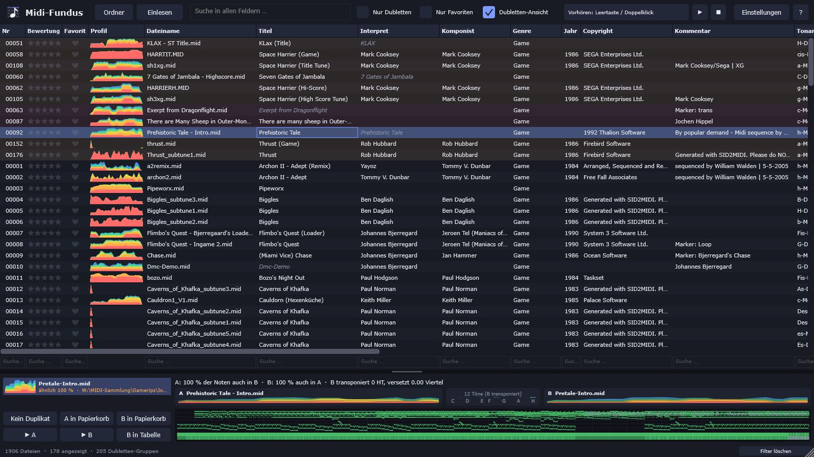
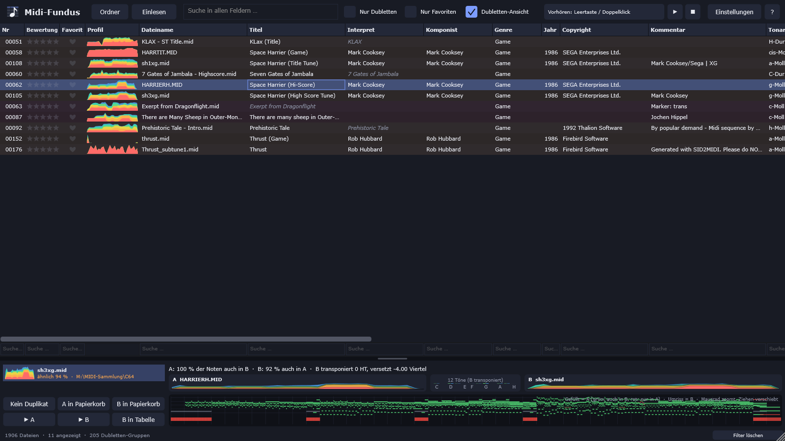
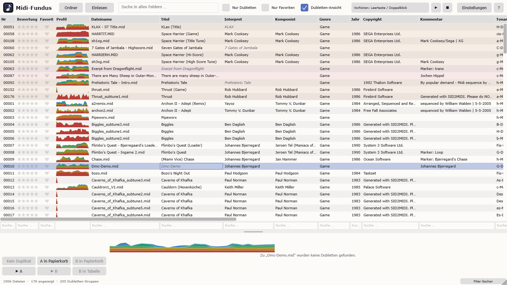

# Midi-Fundus – MIDI-Archiv mit Dublettenfinder (VST3 / Standalone)

Midi-Fundus durchsucht beliebig viele Ordner samt Unterordnern nach MIDI-Dateien und listet alles
Wissenswerte in einer großen, frei einstellbaren Tabelle: Titel, Interpret, Komponist, Genre, Jahr,
Copyright, Tonart, Skala, Tempo, Takt, Dauer, Instrumente, Liedtext und mehr. Schon beim Einlesen
findet es Dubletten – nicht am Dateinamen, sondern an den Noten, auch transponiert oder in anderem Tempo.
Neben MIDI liest es über 20 verwandte Formate – von Spielemusik (XMI, MUS, HMP, CMF, SMAF) über DAW-Projekte
(Cakewalk, FL Studio, Ableton Live, Studio One / Fender Studio Pro, DAWproject, REAPER, Reason) bis zu Noten (MusicXML, MuseScore, ABC, Humdrum)
und UltraStar-Karaoke – und konvertiert jede Datei per Rechtsklick nach MIDI, MusicXML, ABC, DAWproject, REAPER oder Ableton Live Set.
Läuft als VST3 in jeder DAW oder als eigenständiges Programm; Oberfläche auf Deutsch, Englisch und Französisch.



## Download
Windows-Installer (VST3 + Standalone): **[Releases](https://github.com/Yakobo1970/Midi-Fundus/releases/latest)** –
`Midi-Fundus-<Version>-Setup.exe` ausführen; das VST3 landet in `C:\Program Files\Common Files\VST3`.
Projektseite: https://www.undabtanzbar.de/software/midi-fundus/

| Dubletten-Ansicht | Helles Thema |
|---|---|
|  |  |

## Funktionen
- **Einlesen:** beliebig viele Ordner (auch per Drag & Drop ins Fenster), rekursiv, `.mid` `.midi` `.kar` `.rmi` und alle Formate aus der Tabelle unten;
  parallel, unveränderte Dateien werden beim nächsten Mal übersprungen. Erprobt mit rund 90 000 Dateien.
  Kommt ein Ordner hinzu, wird nur er eingelesen – ein Fenster fragt, welche der vorhandenen Ordner mitgelesen werden sollen.
- **Schreibschutz je Ordner:** im selben Fenster (oder „Ordner“ → „Ordner verwalten …“) – in geschützten Ordnern ändert, verschiebt
  und löscht Midi-Fundus nichts (auch nicht als Ziel von Kopieren, Verschieben oder Konvertieren); ihre Dateien erscheinen rötlich.
- **Ordner entfernen:** „Ordner“ → Ordner → „Aus dem Fundus entfernen“ nimmt den Ordner samt Einträgen aus der Datenbank (die Dateien bleiben);
  Einträge ohne Ordner (aus älteren Versionen) räumt „Ordner“ → „… Einträge ohne Ordner entfernen“ auf.
- **Analyse:** Tonart, Skala, Tempo, Takt, Dauer, Spuren, Kanäle, Notenanzahl, GM-Instrumente, Liedtext (Karaoke),
  Sprache des Liedtexts und ein „Notengebirge“ als Mini-Profil jeder Datei.
- **Tabelle:** Spalten sortieren, verschieben, verbreitern, ein- und ausblenden; unter jeder Spalte ein eigenes
  Suchfeld (mehrere Wörter, `!wort` = enthält nicht, `=` = leer, `!` = nicht leer, Bereiche wie `1984-1989`),
  dazu eine Suche über alle Felder. Bewertung mit Sternen und Favoriten.
- **Direkt bearbeiten:** Titel, Interpret, Komponist, Genre, Jahr, Copyright, Sprache, Kommentar und Tonart werden
  sofort in die MIDI-Datei geschrieben (das Original wird vorher einmalig gesichert, die Noten bleiben unangetastet).
  Bedienung wie in einer Tabellenkalkulation: Pfeiltasten wandern von Zelle zu Zelle (bearbeitbare Felder stehen markiert offen,
  Lostippen ersetzt; nach einer Änderung, einem Klick ins Feld oder F2 bewegen links/rechts den Cursor im Text), Enter speichert und springt
  eine Zeile tiefer, mehrere markierte Zeilen lassen sich auf einmal ändern. **Rückgängig** per Rechtsklick oder Strg+Z.
  Beim Tippen schlägt Midi-Fundus passende Werte aus dem Archiv vor (Titel, Interpret, Komponist, Genre, Copyright, Sprache) –
  passende Anfänge zuerst, sonst alphabetisch; Pfeil hoch/runter wählt, Enter übernimmt.
- **Dubletten:** „identisch“ (Byte für Byte), „gleiche Noten“ (andere Texte/Einstellungen) und „ähnlich nn %“
  (gleiche Melodiefolgen, transpositions- und tempounabhängig). Die Dubletten-Ansicht zeigt beide Dateien als
  Notengebirge, das 12-Ton-Profil und übereinandergelegte Pianorollen: grün = in beiden Dateien, rot = nur in einer.
  „Kein Duplikat“ merkt sich Fehltreffer; gelöscht wird nur nach Rückfrage – in den Windows-Papierkorb.
- **Vorhören:** Leertaste oder Doppelklick – mit eingebautem SoundFont (GeneralUser GS), dem Windows-GM-Synth,
  eingebauten Synth-Klängen oder als MIDI an die DAW. Im Plugin auf Wunsch taktgenau mit dem DAW-Transport.
- **In die DAW:** Zeilen anfassen und auf eine Spur ziehen – auch mehrere Dateien auf einmal.
- **UltraStar:** Karaoke-Songs (`.txt` mit `#TITLE`/`#BPM`) erscheinen mit Format „UltraStar“: Gesangsmelodie, Liedtext, Sprache,
  Duette (P1/P2), Relativ-Modus, UTF-8 und Windows-1252. Titel, Interpret, Genre, Jahr, Sprache und Kommentar werden in die Kopfzeilen
  geschrieben (Kodierung bleibt). In die DAW gezogen wird daraus eine MIDI-Datei.
- **Konvertieren:** Rechtsklick → Datei → „Konvertieren nach“ – jede Datei (eine mit frei wählbarem Namen im Speichern-Dialog,
  mehrere markierte in einen Ordner) als
  MIDI (`.mid`, SMF Typ 1 – für jede DAW), MusicXML (`.musicxml`, Version 3.1 – für MuseScore 3 und neuer, Finale,
  Sibelius, Dorico …; quantisiert auf Sechzehntel und Triolen, bis zu vier Stimmen je System, Haltebögen über Taktgrenzen,
  Schlagzeug als Percussion-Notation), ABC (`.abc`, Version 2.1 – eine Melodie je Spur), DAWproject (`.dawproject`, Version 1.0 –
  für Bitwig 5 und neuer, Studio One 6.5 und neuer / Fender Studio Pro, Cubase 14 und neuer; je Instrument eine Spur mit Clip,
  Tempo- und Taktwechsel, Marker, Lautstärke und Panorama, Titel und Interpret), REAPER (`.rpp`, eine MIDI-Spur je Instrument
  inklusive aller Controller) oder Ableton Live Set (`.als`, Live 11/12 – eine MIDI-Spur je Instrument mit Clip, Pitchbend,
  Tempo- und Taktwechseln als Automation, Marker als Locators, Programmwechsel im Clip; gebaut aus den Vorlagen der installierten
  Live-Version, daher nur mit Ableton Live auf dem Rechner). Jedes Lied bekommt einen Ordner `<Lied>/<Lied>.als` mit `Samples/`:
  jede Spur hat als Platzhalter einen Ableton-Sampler mit den Original-Wellen aus dem GM-SoundFont GeneralUser GS (nur die Zonen
  der gespielten Tasten, mit Loops, Grundton, Feinstimmung, Anschlagsebenen und Hüllkurve; Schlagzeug als Sampler mit einer Zone
  je Instrument). Der Sampler braucht Live Suite oder Standard. Bei DAWproject und REAPER weist man die Instrumente selbst zu –
  der GM-Klang steht im Spurkommentar.
- **Recherche:** Rechtsklick → Internetsuche, automatische Suche fehlender Angaben (MusicBrainz, Wikidata)
  und ein „Deep-Modus“, der über die Melodie verwandte Dateien findet.
- **Lupe:** Rechtsklick auf eine Stelle ohne eigenes Menü (in der Tabelle: Zeilenmenü → „Lupe“) – eine Bildschirmlupe folgt der Maus,
  2- bis 4-fach, drei Größen.
- **Updates:** einmal am Tag eine Anfrage an GitHub; gibt es eine neue Version, erscheint oben ein grüner Knopf. Es wird nur diese
  Anfrage gesendet; abschaltbar unter Einstellungen.
- **Dateien verwalten:** kopieren, verschieben (Bewertung und Daten bleiben erhalten), in den Papierkorb legen;
  Titel und Interpret aus dem Dateinamen übernehmen.
- **Oberfläche:** sechs Farbthemen, jeweils hell und dunkel; Sprache Deutsch/Englisch/Französisch (live umschaltbar);
  eingebaute Hilfe und Tooltipps über „?“.

Die Datenbank liegt in `%APPDATA%\MIDIARCHIV` und wird von Standalone und Plugin gemeinsam genutzt.

## Unterstützte Formate
Alle Formate werden beim Einlesen intern in MIDI umgewandelt – Tonart, Dubletten, Vorhören, Pianorolle und das Ziehen in die DAW
funktionieren damit wie bei MIDI. Bearbeiten (in die Datei schreiben) geht bei MIDI und UltraStar; alle anderen sind schreibgeschützt.

| Format | Endungen | Herkunft | Was gelesen wird |
|---|---|---|---|
| Standard-MIDI | `.mid` `.midi` `.smf` `.kar` `.rmi` | überall | alles, inklusive Liedtext (KAR) und RIFF-Hülle (RMI) |
| UltraStar | `.txt` | Karaoke-Spiele (UltraStar Deluxe, Vocaluxe …) | Gesangsmelodie, Liedtext, Duette, Kopfzeilen (schreibbar) |
| XMI | `.xmi` | Miles Sound System (Ultima, Wizardry, Dark Sun …) | erste Sequenz, 120-Hz-Zeitbasis |
| MUS | `.mus` | DMX (Doom, Heretic, Hexen) | alle Kanäle, 140-Hz-Zeitbasis |
| HMP | `.hmp` | Human Machine Interfaces (Descent …) | alle Spuren (alte und 013195-Variante) |
| CMF | `.cmf` | Creative Music File (Sound Blaster) | Noten, Titel, Komponist, Bemerkung |
| SMAF | `.mmf` | Yamaha-Handy-Klingeltöne („Handyphone Standard“, MA-1/MA-2) | 16 Kanäle inkl. Schlagzeug; MA-3/5 „Mobile Standard“ nicht |
| Cakewalk | `.wrk` | Cakewalk / Pro Audio (WRK-Version 2 und 3) | Spuren, Segmente, Tempo, Takt, Titel, Autor, Copyright |
| FL Studio | `.flp` | FL Studio (geprüft mit 20.7) | Pattern-Noten über die Playlist platziert, Kanalnamen, Tempo |
| Ableton Live | `.als` | Live 11 und 12 (geprüft) | Arrangement-Clips (oder Session-Szenen nacheinander), Loops, Tempo |
| Studio One | `.song` | Studio One / Fender Studio Pro (geprüft mit Studio One 6 und 7) | Musik-Spuren und -Parts, Tempo, Titel, Interpret, Genre, Jahr |
| DAWproject | `.dawproject` | offenes Austauschformat: Bitwig 5+, Studio One 6.5+ / Fender Studio Pro, Cubase 14+ | Arrangement-Clips (oder Szenen nacheinander), Loops, Clip-Verweise, Tempo- und Taktwechsel, Marker, Metadaten |
| REAPER | `.rpp` | REAPER (Textformat) | MIDI-Items aller Spuren, Loops, Startversatz, aktiver Take, Tempo-Hüllkurve, Marker, Render-Metadaten, Projektnotizen |
| Reason | `.reason` `.rps` `.rns` | Reason (geprüft: .rns, .rps ab 4.0, .reason bis 12) | nur Tempo, Taktart, Länge, Titel, Version – die Noten speichert Reason verschlüsselt |
| MusicXML | `.musicxml` `.xml` `.mxl` | Notenprogramme | Stimmen, Haltebögen, Akkorde, Tempo, Schlagzeug, Liedtext |
| MuseScore | `.mscz` `.mscx` | MuseScore (geprüft mit 1.x; 2–4 nach Formatbeschreibung) | Systeme, Stimmen, Triolen, Haltebögen, Tempo, Titel |
| ABC | `.abc` | Volksmusik-Sammlungen (thesession.org …) | erstes Stück der Datei, Stimmen, Liedtext |
| Humdrum | `.krn` | KernScores (Klassik) | alle `**kern`-Spalten, Tempo, Taktart, Titel, Komponist |

Die Leser wurden an echten Dateien geprüft (u. a. 853 Studio-One-Songs, 2 607 SMAF-Klingeltöne mit 774 MIDI-Gegenstücken,
138 Cakewalk-, 212 XMI-, 14 HMP- und 573 Reason-Dateien); ABC, Humdrum, MUS, CMF, DAWproject und REAPER an eigenen
Testdateien nach der jeweiligen Formatbeschreibung. DAWproject-, REAPER- und Ableton-Export werden per Rundlauf geprüft (alle Noten,
Länge, Schlagzeug und Titel identisch).

## Bauen
```
cmake -B build -G "Visual Studio 18 2026" -A x64
cmake --build build --config Release --target MIDIARCHIV_VST3 MIDIARCHIV_Standalone
```
JUCE wird unter `%USERPROFILE%\JUCE` erwartet (`-DJUCE_DIR=…` zum Überschreiben).
Installer: `ISCC installer\MIDIARCHIV.iss` (Inno Setup 7) → `dist_installer\Midi-Fundus-<Version>-Setup.exe`.

## Tests
Alle Testprogramme mit der Umgebungsvariable `MIDIARCHIV_DB` auf eine **Kopie** der Datenbank richten.
- `ArchivTest info|write <datei>`, `ArchivTest scan <db> <ordner>`, `ArchivTest groups <db>`, `ArchivTest lang`, `ArchivTest fileops <mid>`, `ArchivTest ultrastar`, `ArchivTest formats`, `ArchivTest projects`, `ArchivTest export <datei…>`, `ArchivTest update`, `ArchivTest batch <liste> <ergebnis>`
- `UiShot shot <out.png> [breite höhe] [select n] [dupsonly] [light] [about] [keys] [suggest] [loupe x y] [clean]` – rendert die Oberfläche; `keys` prüft Tastatursteuerung und Rückgängig, `suggest` die Vorschläge (schreibt in Dateien – nur mit kopierten MIDIs)
- `UiShot synctest`, `UiShot voicetest`, `UiShot carrytest` – Wiedergabe, DAW-Sync, hängende Stimmen
- `HostTest <Midi-Fundus.vst3>` – lädt das VST3 wie eine DAW
- `python Tools/check_lang.py` – prüft, dass jeder Text auf Englisch und Französisch vorliegt

## Lizenz & Dank
Eigener Code: MIT-Lizenz (siehe `LICENSE`). Gebaut mit [JUCE](https://juce.com).
Enthalten: [TinySoundFont](https://github.com/schellingb/TinySoundFont) (MIT, `Source/ThirdParty/LICENSE_tsf.txt`)
und der SoundFont [GeneralUser GS](https://schristiancollins.com/generaluser.php) von S. Christian Collins
(frei, auch zur Weitergabe; `Resources/SoundFont/LICENSE_GeneralUser.txt`).
Online-Daten von [MusicBrainz](https://musicbrainz.org) und [Wikidata](https://www.wikidata.org) – nur auf Anforderung per Rechtsklick.
VST ist eine Marke der Steinberg Media Technologies GmbH.

Idee, Konzept und Regie: Kay „Yakobo“ Fiedler – umgesetzt mit Claude (Anthropic).
Kostenlos – wer mag, kann per [PayPal](https://paypal.me/yakobo) etwas spenden.
Kay „Yakobo“ Fiedler · https://www.undabtanzbar.de · https://github.com/Yakobo1970
